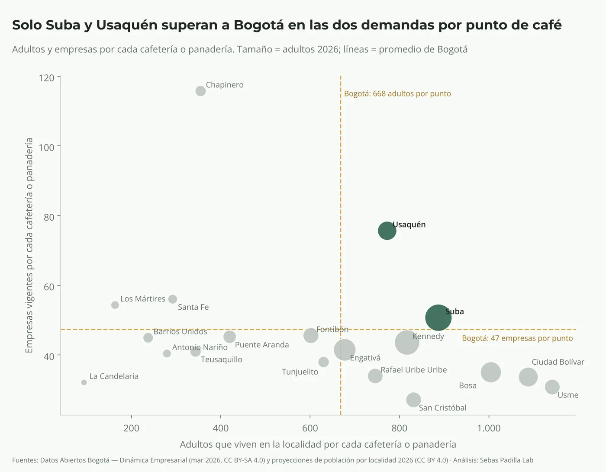

---
# ── Ficha del caso para el sitio Sebas Padilla Lab ─────────────────────────────
# Este archivo convierte el repositorio en un proyecto del sitio. Para que aparezca:
#   1. el repositorio debe tener el tema "sp-lab" (About → Topics), y
#   2. "publicar" debe estar en true.
# El sitio lo lee una vez al día (o al instante si configuras el aviso; ver LEEME-SP-LAB.md).

publicar: false                    # true = publicar en el sitio; false = borrador
url: nombre-corto-del-caso         # dirección: /es/proyectos/<url>/ (minúsculas y guiones)
titulo: "¿Pregunta que responde el caso?"
pregunta: "Pregunta de negocio, en una línea"
hallazgo: "el hallazgo principal en una frase, con su cifra."
descripcion: "Una o dos frases para buscadores y redes."
pilar: data                        # data | ml | mi (Market Intelligence)
industria: comercio                # comercio | salud | emprendimiento | alimentos | finanzas | industria | educacion | logistica
herramientas: [Python, pandas]
fecha: "nov 2026"                  # si se omite, se usa el mes en que se creó el repositorio
portada: ../graficos/01_grafico_principal.png   # imagen de la tarjeta (ruta relativa a esta carpeta)
orden: 10                          # posición en Proyectos (1 = primero)
destacado: false
etiquetaDatos: "datos abiertos"    # datos abiertos | datos sintéticos | resultados agregados
# lineaEquipo: "Trabajo en equipo con …"   # solo si es trabajo en equipo
ficha:
  - dato: "Autoría"
    valor: "Sebastián Padilla (proyecto individual)"
  - dato: "Método"
    valor: "…"
  - dato: "Herramientas"
    valor: "Python · pandas · matplotlib"
  - dato: "Fuentes"
    valor: "…"
  - dato: "Estado"
    valor: "v1 terminada"
sobreLosDatos: "De dónde salen los datos, su licencia y por qué no hay información personal ni del empleador."
licencia: "Datos, tablas y gráficos bajo CC BY 4.0. Código con todos los derechos reservados."
# repo: se llena solo con la dirección de este repositorio
---

## La pregunta de negocio

> La pregunta en una frase destacada.

Por qué importa y qué decisión depende de ella.

## Los datos

Qué datos se usaron y qué tan confiables son.

```cifras
21.407 | empresas nuevas
19 | localidades
3 | meses
```

## El enfoque

Cómo se analizó, en pasos.

1. **Paso uno:** …
2. **Paso dos:** …

## Los hallazgos

**Hallazgo uno.** Texto con la cifra.



| Columna | Valor |
| --- | --- |
| Fila | 1,0 |

## La decisión recomendada

> Qué haría yo con esta evidencia, en una frase.

Detalle de la decisión y cómo medir si funcionó.

## Limitaciones y próximos pasos

- Lo que los datos no dicen.
- La versión 2.
